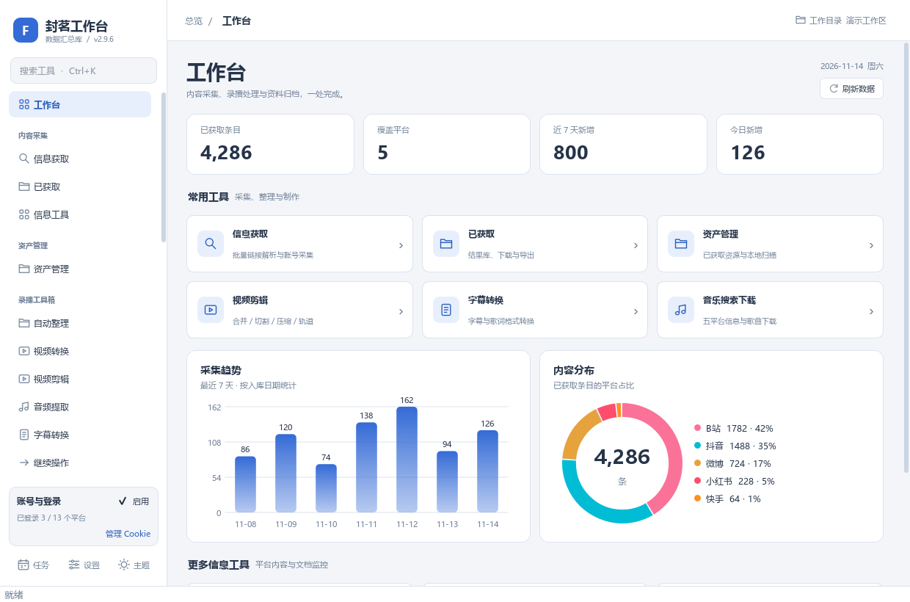
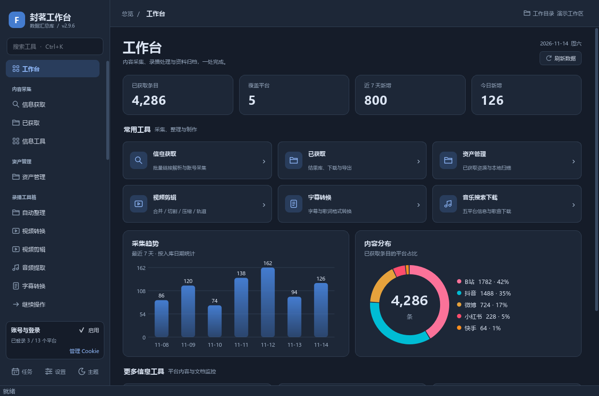
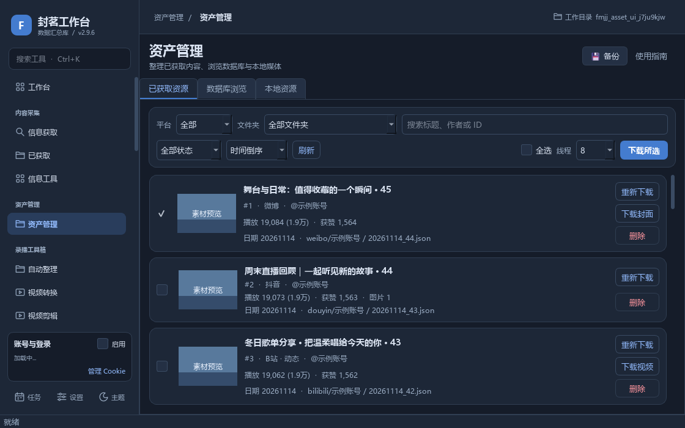
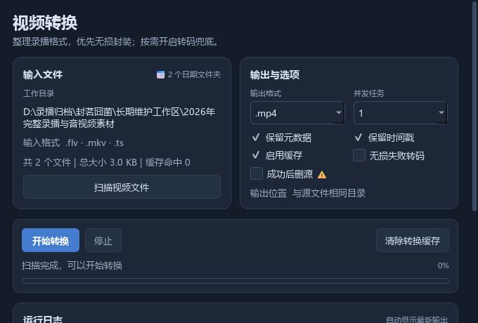

# 工作台重构与暗色主题修复

## 问题与结果

用户截图显示：切换到深色后页面背景仍为浅色，资产列表文字已变浅；导航选中状态混色；视频转换页的标签各自出现深色矩形。主题更新必须覆盖已有页面、切换后新打开的页面和弹窗，同时保持多工具页加载后的响应速度。

本次修复主题缓存与样式继承，并重构工作台、导航、首页、资产管理、视频转换和信息获取相关操作区。功能入口、数据格式和采集/下载能力保留。

## 主题机制

- Qt 样式表会缓存 `palette()` 的颜色，仅 `QApplication.setPalette()` 不会让既有控件的样式全部换色。现在保持全局及内联模板稳定，更新调色板后重新 polish 当前可见控件，隐藏分支在显示前同步。
- 使用直接子控件遍历并跳过隐藏分支，避免几十个已加载页面同时全量 repolish。窗口更新期间暂停重绘，减少文字和背景分开更新的中间帧。
- 保存内联样式的原文，将旧中性色一次转换为配色角色；不从上次渲染结果反向猜色，多次切换不会漂移。URL、引号文本、注释和选择器属性值受保护。
- 普通标签保持透明并继承卡片背景；页面和独立窗口有明确底色。重新挂入父控件时清理自动窗口表面标记，避免小色块。视频纯黑预览与透明浮层继续保留。
- `Show`、`ParentChange`、`DynamicPropertyChange` 覆盖懒加载、弹窗、重新挂载控件与按钮状态变化；隐藏按钮改状态后再显示也会刷新。
- 富文本通过原位格式更新处理正文、次级文字和链接，保留图片资源、链接地址、选择和滚动位置。危险按钮悬停使用有足够对比度的文字。
- Windows 原生标题栏跟随应用主题；隐藏控件不会因此创建原生窗口。手动、定时、跟随系统的现有设置继续生效。

## 界面改造

- **工作台与导航**：统一品牌、线形图标和当前页面/工作目录顶栏；`Ctrl+K` 搜索全部工具，回车打开；信息工具的搜索、首页和直接跳转复用同一容器及子页，避免重复任务实例。
- **首页**：指标、常用工具、采集趋势、平台分布、更多工具分区；窄窗自动改为两列工具/指标和纵排图表，工具卡支持键盘操作。
- **资产管理**：三个页签统一工具栏与卡片；筛选和操作分两行，标题、作者、统计、来源、状态可读。快速刷新先隐藏旧行再延迟释放，消除旧卡片重影与分页重叠。主题切换不扫描磁盘或重载缩略图。
- **视频转换**：输入文件、输出选项、操作进度、运行日志独立分区；窄宽度改为单列，全部配置与按钮保留。工作线程收尾通过主线程桥恢复按钮，成功/失败/取消都覆盖。
- **已获取与账号获取**：工具栏分行；平台栏在窄窗采用 2×2，较宽窗口并排四栏，复用原列表保持选中/滚动。账号编辑行、策略/限流/日期、进度说明和保存提示可伸缩；修正浅色选中卡片的白字问题。
- 默认窗口 1240×820，最低仍支持 880×560；原有快捷键、拖放、生命周期、所有导航入口保持。

## 验证

环境：Windows、Python 3.14.8、PySide6 6.12.0，覆盖 offscreen 和 Windows 原生后端（150% DPI）。配置、账号、媒体和数据库全部使用合成内容或临时目录，网络被禁止；未执行真实转换或平台采集。

| 检查 | 结果 |
| --- | --- |
| 运行时主题回归 | 10 项通过，实际窗口/文字/输入框像素、多次切换、隐藏与晚创建页、窗口重挂、字面量保护、选中/禁用/悬停状态 |
| 全部真实页面 | 35 个注册页在同一窗口完成浅→深→浅，页面底色与文字检查通过；Windows 原生切换约 0.13～0.16 秒 |
| 大规模切换基准 | 61 页 / 5616 个控件 / 当前可见 96 个，Windows `apply_theme` 约 14～15ms，含事件处理约 34～41ms；模板字符串稳定，缓存页面与晚创建页像素正确 |
| 视频转换 | 7 项通过，默认/自定义配置、扫描/缓存/日志与旧版一致，成功/失败/取消在主线程恢复；680/1000/540 宽度可用 |
| 信息页响应布局 | 5 项通过，680/1000 宽度、筛选/操作回调/设置持久化、列表顺序/链接/flags/勾选保持；日期每条每次刷新解析一次 |
| 资产管理 | 45 条资产 / 9 条数据库记录 / 27 个本地资源，三页签筛选/分页/选中/定点替换/下载删除回调、四类详情窗均通过；16 个核心函数 AST 与改前一致，主题切换没有额外 I/O |
| 工作台与富文本 | 全部搜索/首页入口、真实容器复用、键盘与生命周期、主题往返通过；正文/图片/链接/选区/滚动保持 |
| 工程 | 208 个 Python 文件编译、`git diff --check` 通过，无新增运行依赖 |

按仓库既有约定，验证脚本和环境保留在被忽略的 `_smoke/` 中。下列是最终可复现检查命令，部分检查从 `HEAD` 读取改前基线，需在提交前执行：

```powershell
python -X utf8 _smoke/check_theme_runtime.py
python -X utf8 _smoke/check_real_pages_theme.py
python -X utf8 _smoke/check_convert_redesign.py
python -X utf8 _smoke/check_convert_redesign.py -platform windows
python -X utf8 _smoke/check_responsive_info.py
python -X utf8 _smoke/verify_asset_ui.py
python -X utf8 _smoke/verify_workbench_redesign.py
python -X utf8 _smoke/verify_rich_text_theme.py
python -m compileall -q src main.py build.py
git diff --check
```

主题及全页原生检查通过环境变量 `FMJJ_QT_PLATFORM=windows` 运行，完成后清除变量；转换页脚本支持 `-platform windows`。大规模基准包含截图像素验证时的页面显示耗时不能直接作为实际切页时间。界面验证覆盖构造、显示和操作路由，平台登录后完整采集、真实媒体转换仍按既有引擎能力运行。

## 审核预览

下列图片使用固定合成示例数据，未包含真实账号、媒体内容或登录状态。其余 QA 截图保留在 `_smoke/`。

| 浅色工作台 | 深色工作台 |
| --- | --- |
|  |  |




